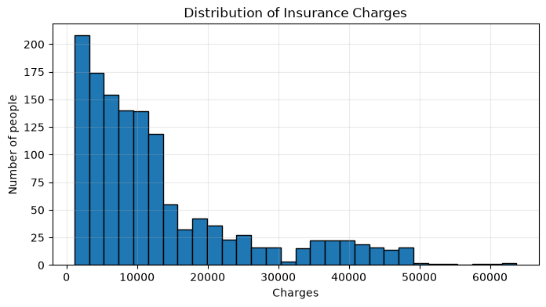
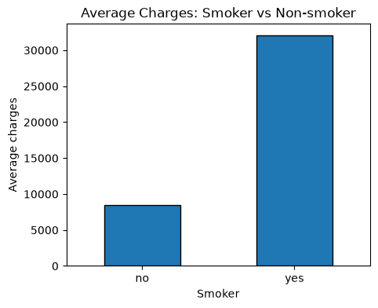
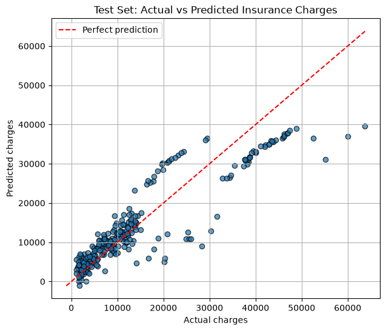

# InsurancePriceML
### Health Insurance Premium Prediction using Linear Regression

Predicts a person's health insurance charges based on age, BMI, smoking status, and other personal details using Linear Regression.

*AI101 Mini-Project* · School of AI and Data Engineering, IIT Ropar · Team 25 · Python 3.12

## Table of Contents

- [Project Overview](#project-overview)
- [Team Members](#team-members)
- [Project Structure](#project-structure)
- [Dataset Description](#dataset-description)
- [Setup and Installation](#setup-and-installation)
- [Steps to Run](#steps-to-run)
- [Expected Output](#expected-output)
- [Project Resources](#project-resources)
- [AI Use Disclosure](#ai-use-disclosure)

## Project Overview

This project uses *Linear Regression*, a supervised machine learning algorithm, to predict individual health insurance premiums based on demographic and lifestyle-related features.

### Technologies Used

- Python 3.12
- Pandas
- NumPy
- Matplotlib
- Seaborn
- Scikit-learn

## Team Members

| Member Name          | Entry Number | GitHub Profile                                   | Role               |

| Harshit Agarwal      | 2026EEB1353  | [GitHub](https://github.com/HarshitAgrawal-2030) | Execution Lead |
| Aryan Hemant Sawant | 2026MCB1516  | [GitHub](https://github.com/aryan-s-iitrpr)      | video Lead  |
| Harshit Bansal       | 2026ESB1476  | [GitHub](https://github.com/HarshitBansal-2008)  | PPT Lead   |
| Gajjela Sri Charan   | 2026AIB1033  | [GitHub](https://github.com/sricharan-iitrpr)    | Documentation Lead  |

*Contribution:* All four team members contributed to the codebase. Refer to the Git commit history for details.

## Project Structure

text
InsurancePriceML/
│
├── data/
│   └── insurance.csv
│
├── notebooks/
│   ├── Insurance_Premium_Linear_Regression.ipynb
│   └── insurance.csv
│
├── Insurance_Premium_Prediction_AI101.pptx
├── expected_output.png
├── requirements.txt
├── .gitignore
└── README.md

## Dataset Description

The project uses the *Medical Cost Personal Dataset* available on Kaggle.

- Total records: 1,338
- Total columns: 7
- Missing values: None
- Duplicate records: 1 duplicate row removed during preprocessing.

### Dataset Features

| Column     | Description                             |

| age      | Age of the person                       |
| sex      | Gender (male/female)                    |
| bmi      | Body Mass Index                         |
| children | Number of children covered by insurance |
| smoker   | Smoking status (yes/no)                 |
| region   | Residential region                      |
| charges  | Insurance charges (target variable)     |

## Setup and Installation

### Prerequisites

Make sure the following are installed:

- Python 3.12
- Git
- Jupyter Notebook

### 1. Clone the Repository

bash
git clone https://github.com/HarshitAgrawal-2030/InsurancePriceML.git

cd InsurancePriceML

### 2. Create a Virtual Environment

bash
python -m venv venv

### 3. Activate the Virtual Environment

*Windows:*

bash
venv\Scripts\activate

*Linux/macOS:*

bash
source venv/bin/activate

### 4. Install Dependencies

bash
pip install -r requirements.txt

## Steps to Run

Make sure you are inside the repository folder and your virtual environment is active.

### 1. Execute the Complete Notebook

bash
jupyter nbconvert --to notebook --execute notebooks/Insurance_Premium_Linear_Regression.ipynb --output executed_output.ipynb --output-dir notebooks

### 2. Open the Executed Notebook

bash
jupyter notebook notebooks/executed_output.ipynb

Alternatively, you can run the original notebook interactively:

bash
jupyter notebook notebooks/Insurance_Premium_Linear_Regression.ipynb

Then select *Run → Run All Cells*.

*Note:* The notebook reads insurance.csv using a relative path from the notebooks directory. Keep the dataset copy in that directory.

## Expected Output

The notebook prints the dataset shape, training and testing sizes, evaluation metrics, and an example prediction.

## Visualizations

### 1. Distribution of Insurance Charges

### 2. Smoker vs Non-smoker Charges

### 3. Actual vs Predicted Insurance Charges

### Dataset Split

| Dataset      | Number of Records |

| Training Set |             1,069 |
| Testing Set  |               268 |

### Model Evaluation Metrics

The following results are obtained on the test set using random_state=42.

| Evaluation Metric              |   Test Result |

| Mean Absolute Error (MAE)      |      4,177.05 |
| Mean Squared Error (MSE)       | 35,478,020.68 |
| Root Mean Squared Error (RMSE) |      5,956.34 |
| R² Score                       |         0.807 |

### Example Prediction

*Input:*

- Age: 30
- Sex: Male
- BMI: 27.5
- Children: 1
- Smoker: No
- Region: Southeast

*Predicted Insurance Premium:* 4,710.51

### Visualizations

The notebook generates the following visualizations:

- Distribution of insurance charges (Histogram)
- Age-based analysis
- Smoking status analysis
- Actual vs. Predicted values
- Residual distribution (Histogram)

## Project Resources

- *Presentation:* [Insurance Premium Prediction – AI101](Insurance_Premium_Prediction_AI101_1.pptx)
- *Project Notebook:* [Insurance_Premium_Linear_Regression.ipynb](notebooks/Insurance_Premium_Linear_Regression.ipynb)
- *Dataset:* [Medical Cost Personal Dataset – Kaggle](https://www.kaggle.com/datasets/mirichoi0218/insurance)
- *Project Video:* [Unlisted Video Link](https://youtu.be/3NJEtq5RbgU)

## AI Use Disclosure

The team used generative AI tools as supplementary resources throughout the project:

- *Google Gemini and Grok:* Used for exploring and refining the project structure, understanding several GitHub commands, and assisting with repository organization.
- *ChatGPT (GPT):* Used for preparing the initial presentation (PPT), inspecting and understanding code, and providing technical guidance.

AI-generated suggestions were reviewed and adapted by the team. The project implementation, experimentation, model evaluation, and final decisions were carried out and validated by the team.
